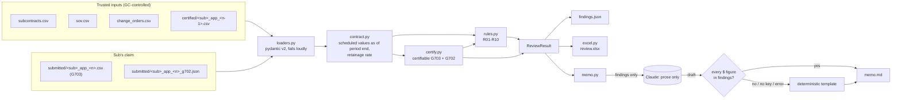

# payapp-reconciler

[](https://github.com/Deepikapriya9779/payapp-reconciler/actions/workflows/ci.yml)

Automated review of subcontractor pay applications (AIA G702/G703 progress billing) for general
contractors.

## The problem

Every month, each subcontractor on a job sends the GC a pay application. It has two parts:

- a **G702**, the one-page summary: original contract sum, change orders, work completed and
  stored to date, retainage, what was already paid, and the current payment due;
- a **G703** continuation sheet with one row per **schedule of values (SOV)** line. Each row
  shows the scheduled value, work completed on previous applications, work this period,
  materials stored on site, the total to date, % complete, balance to finish, and retainage.

Before anything goes to the owner, a project accountant or PM checks every application by hand:

- Does the math tie out, row by row and from the G703 up to the G702?
- Does "work completed from previous application" match what **we certified** last month, or
  did the sub carry forward its own number after we cut it?
- Is anyone billing more than 100% of a line?
- Is anyone billing against a change order that hasn't been approved, or isn't in the log at all?
- Is retainage right, including the drop from 10% to 5% once the job passes 50%?
- Are stored materials backed up with an invoice, a bill of lading and insurance?
- Are general conditions billed ahead of the actual work (front-loading)?

With 20 to 40 subs a month, that checking is slow, and the mistakes it misses cost real money.
`payapp-reconciler` runs those checks in seconds. It rebuilds the amount the GC can actually
certify from sources the GC controls, and drafts the correction memo back to the sub.

## Core design principle

**All numbers are computed deterministically in Python with `Decimal`, never floats.** The LLM is
used **only** to draft the plain-English memo from the structured findings. It never does math and
never decides what is certifiable. Every dollar figure in its draft is checked against the
findings, and if one doesn't match, the tool falls back to a deterministic template.

## Demo

On the fictional sample project, Sonoran Air Mechanical's Application No. 4 bills half of a
change order that is still pending, and adds that CO to G702 line 2:

```text
$ payapp-reconcile data/sample --sub mech --app 4 --memo
Desert Ridge Medical Office Building  |  Sonoran Air Mechanical (mech), Mechanical (HVAC &
Plumbing)
Pay Application No. 4, period ending 2026-04-30  |  certifiable 57.36% complete, retainage 5%
G702: claimed vs. certifiable
+--------------------------------------------------------------------------------------------+
| Line | Description                            |       Claimed |   Certifiable |   Variance |
|------+----------------------------------------+---------------+---------------+------------|
|    1 | Original Contract Sum                  | $2,450,000.00 | $2,450,000.00 |      $0.00 |
|    2 | Net Change by Change Orders            |    $79,500.00 |    $61,000.00 | $18,500.00 |
|    3 | Contract Sum to Date                   | $2,529,500.00 | $2,511,000.00 | $18,500.00 |
|    4 | Total Completed & Stored to Date       | $1,449,450.00 | $1,440,200.00 |  $9,250.00 |
|    5 | Retainage                              |    $72,472.50 |    $72,010.00 |    $462.50 |
|    6 | Total Earned Less Retainage            | $1,376,977.50 | $1,368,190.00 |  $8,787.50 |
|    7 | Less Previous Certificates for Payment |   $918,391.50 |   $918,391.50 |      $0.00 |
|    8 | Current Payment Due                    |   $458,586.00 |   $449,798.50 |  $8,787.50 |
|    9 | Balance to Finish, Including Retainage | $1,152,522.50 | $1,142,810.00 |  $9,712.50 |
+--------------------------------------------------------------------------------------------+
Findings (2 error, 0 warning, 0 info)
+-------------------------------------------------------------------------------------------------+
| Rule | Severity | Item  | Col |    Impact | Finding                                             |
|------+----------+-------+-----+-----------+-----------------------------------------------------|
| R05  | error    | CO-03 | G   | $9,250.00 | Line CO-03 (Added VAV zone, 2nd floor east): CO-03  |
|      |          |       |     |           | is pending. Billing of $9,250.00 can't be certified |
|      |          |       |     |           | until the change order is approved.                 |
| R08  | error    | -     | L2  |         - | G702 line 2 (Net Change by Change Orders) shows     |
|      |          |       |     |           | $79,500.00 but should be $61,000.00 (change orders  |
|      |          |       |     |           | approved as of 2026-04-30; pending, rejected and    |
|      |          |       |     |           | unlogged COs don't count).                          |
+-------------------------------------------------------------------------------------------------+
Wrote out/mech_app_4/: findings.json, review.xlsx, memo.md (template: ANTHROPIC_API_KEY not set)
```

The run also writes `out/mech_app_4/`:

- `findings.json`: the full review (G702 comparison, certifiable lines, findings), with
  Decimals as strings.
- `review.xlsx`: three sheets. **Summary** has G702 claimed vs. certifiable vs. variance.
  **Line Review** is the submitted G703 with certifiable columns, with problem cells filled red,
  amber or blue and a comment on each explaining the finding. **Findings** is the full table.
- `memo.md`: the memo to the sub listing the corrections.

Results across all 15 sample applications (3 subs × 5 months):

| Sub | App | Planted | Findings | Requested | Certifiable | Variance |
|---|---:|---|---|---:|---:|---:|
| mech | 1 | clean | none | $171,990.00 | $171,990.00 | $0.00 |
| mech | 2 | math error | R01 | $276,084.00 | $267,084.00 | $9,000.00 |
| mech | 3 | stored materials | R07 | $479,317.50 | $479,317.50 | $0.00 |
| mech | 4 | billing on a pending CO | R05, R08 | $458,586.00 | $449,798.50 | $8,787.50 |
| mech | 5 | over-billed line | R04 | $473,494.25 | $464,184.25 | $9,310.00 |
| elec | 1 | clean (PM field cut) | none | $249,750.00 | $249,750.00 | $0.00 |
| elec | 2 | wrong from-previous | R03 | $304,101.00 | $277,101.00 | $27,000.00 |
| elec | 3 | missed retainage reduction | R06 | $485,109.00 | $539,829.00 | -$54,720.00 |
| elec | 4 | clean | none | $410,485.50 | $410,485.50 | $0.00 |
| elec | 5 | billing on a CO not in the log | R05, R08 | $307,876.00 | $293,863.50 | $14,012.50 |
| dryw | 1 | clean | none | $79,128.00 | $79,128.00 | $0.00 |
| dryw | 2 | front-loaded general conditions | R09 | $161,784.00 | $161,784.00 | $0.00 |
| dryw | 3 | G702 doesn't tie | R08 | $241,344.00 | $232,344.00 | $9,000.00 |
| dryw | 4 | clean | none | $231,840.00 | $231,840.00 | $0.00 |
| dryw | 5 | duplicate line | R10 | $220,248.00 | $175,896.00 | $44,352.00 |

Warnings (stored materials, front-loading) don't change the certifiable amount; they're the PM's call.

The answer key ([data/sample/expected_findings.json](data/sample/expected_findings.json)) lists
**10 planted problems that should produce 12 findings**. The test suite checks that the tool
reports exactly those 12 and nothing else, and that the 5 clean applications produce zero
findings. Electrical app 3 shows the tool is neutral: the sub forgot its own retainage reduction,
so the GC owes **more** than was requested.

## Architecture



## Rules

| ID | Check | Severity | Dollar impact |
|----|-------|----------|---------------|
| R01 | Row math: G = D + E + F, H = C − G, % = G / C | error (% alone: info) | claimed G − D+E+F |
| R02 | Scheduled value = SOV + change orders approved as of the period end | error | none (R04 catches the billing) |
| R03 | From previous (D) = prior certificate's D + E; $0 on application 1 | error | claimed D − certified |
| R04 | Over-billing: G above the approved scheduled value | error | G − C |
| R05 | Billing on a pending, rejected or unlogged change order | error (listed but unbilled: warning) | G on that line |
| R06 | Retainage rate, including a missed or early reduction | error | expected − claimed retainage |
| R07 | Stored materials (F > 0) need an invoice, bill of lading and insurance | warning | none |
| R08 | G702 lines 1–9 recomputed and tied to the G703 and prior certificate | error | effect on line 8 |
| R09 | Front-loading: general conditions far ahead of the rest of the work (threshold configurable) | warning | none (judgment call) |
| R10 | Duplicate item numbers, missing SOV lines, extra non-CO lines | error | duplicated or extra G |

Dollar impact is the effect on what the sub asked to be paid, gross of retainage. Positive means
over-claimed. Variance is claimed minus certifiable current payment due.

## Quick start

```bash
git clone https://github.com/Deepikapriya9779/payapp-reconciler.git && cd payapp-reconciler
pip install -e ".[dev]"
payapp-reconcile data/sample --sub mech --app 4 --memo
```

To have Claude draft the memo, copy `.env.example` to `.env` and set `ANTHROPIC_API_KEY`
(optionally `ANTHROPIC_MODEL`, default `claude-sonnet-5-5`). Without a key, or with
`LLM_MODE=mock`, the memo comes from the template. Run the checks with `pytest` and `ruff check .`.
Regenerate the sample with `python scripts/generate_sample.py`.

## Design decisions

- **Certify from trusted inputs, not the sub's arithmetic.** C comes from the SOV plus approved
  COs. D comes from the GC's last certificate. E and F are accepted as claimed, because verifying
  progress in the field is the PM's job. G is capped at C, unapproved CO lines get $0, duplicate
  rows count once, and retainage is recomputed per line. Line 7 is the GC's previous line 6.
- **Column D is prior D + E, not prior G.** Stored materials are not "work completed". When they
  get installed, they are billed in E. This matches the G703 column header.
- **Change orders count as of the period end.** The CO log shows today's status, so an optional
  `approved_date` column lets a March application be reviewed against the COs approved by March.
- **The retainage reduction threshold uses certifiable progress.** That way a sub can't over-bill
  past 50% to trigger an early release.
- **G702 errors are reported where they start.** Source lines are compared to their source.
  Derived lines are compared to the sub's own upstream lines. One keying error gives one
  finding, not four.
- **The LLM writes prose only, behind a numeric guardrail.** There is a template fallback, the
  client is injected for tests, and the network is never called in CI.
- **Small and explicit.** argparse, pydantic, openpyxl, rich and the Anthropic SDK. No framework.
  Rules live in one module behind a 10-line registry.

More detail is in [docs/DESIGN.md](docs/DESIGN.md). A guided walkthrough is in
[LEARNING.md](LEARNING.md).

## Limitations

- **It doesn't read PDF pay applications yet.** Inputs are CSV and JSON exports.
- **The sample data is synthetic.** The project, companies and numbers are fictional. The tool
  hasn't been run against a real job's pay apps.
- It accepts the sub's claimed progress (E and F). It can't see the jobsite, so the PM's field
  walk is still required. The sample shows two such PM field cuts.
- One retainage rate covers both completed work and stored materials. G702 lines 5a/5b at
  different rates are not modeled. The reduction rule implements one common convention: the
  reduced rate applies to all work to date once the threshold is reached. Some contracts
  differ, and most need GC, owner or surety approval to release.
- Front-loading uses the sub's overall % complete as a stand-in for schedule progress. There is
  no schedule input.
- Change-order lines are recognized by a `CO` item-number prefix. Lien waivers, insurance
  certificates and certified payroll are not checked.

## Roadmap

- PDF and Excel G703 ingestion: extract into the same pydantic models, have a person confirm the
  extraction, then run the same deterministic checks.
- Batch mode: review every sub for a month and roll up a GC-level summary.
- Lien waiver tracking (conditional and unconditional, progress and final) tied to prior payments.
- Separate retainage on stored materials (G702 5a/5b) and configurable reduction conventions.
- Schedule-based front-loading (billed % vs. % of duration elapsed).
- Import from construction-management and pay-app platform exports.

## License

MIT. See [LICENSE](LICENSE).
